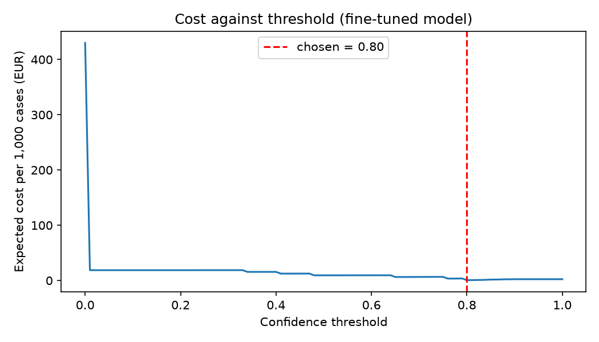

# Assignment 2 Report

- **Name**: Matias Viguera Barrientos
- **Student ID**: 18542
- **Email**: mviguera.ieu2022@student.ie.edu
- **Group**: BBADBA 5A

## Business problem, and the cost of being wrong

The business idea comes from gyms not being able to open 24/7 because they require someone on-site to constantly monitor the gym in case of issues. Usually, when lifting heavy weights, there might be an issue called syncope or lifting-induced syncope, that causes the lifter to black out. Moreover, there might be situations in which given the high-intensity workout someone might induce a cardiac arrest or due to natural conditions, something might happen that makes them fall and injure themselves. In these situations there should be someone present in the gym to assist, however, that means the gym has to pay additionally for an employee to keep watch on the gym during the night and changing shifts. So this is how I came up with this AI, with the idea of helping gyms that want to be open 24/7 with no staff on site at night, monitored remotely. This idea came from the Basic-Fit control room "unwell detection", but in this case we have a narrower prototype that detects fall postures. The only one who acts is the remote operator. With this the only decision that the remote operator needs to do is wether to keep looking if its something delicate or respond to the emergency. Therefore, the model doesn't call emergency services right away, it only flags the issue. 
Knowing this, this model considers missed falls as a member staying on the floor with nobody helping or coming. Usually minor falls, occasionally a serious collapse, plus injury claims, liability and reputation. And what a false alert means to us is the operator spending 2 minutes re-checking the camera and logging it. That costs about €0.43 of operator time, so a missed fall (€25,000) is tens of thousands of times more costly than a false alert. Because falls are so rare, this asymmetry, rather than overall accuracy, is what decides where the threshold goes. I have decided to set the missed fall at €25,000 because most falls in a gym tend to be minor incidents and the person gets up unaided, but a small share are serious collapses where if nobody comes there could actually be an issue. €25,000 sits at the upper end of Spanish gym-injury claims (about €5,000–30,000),  covering a typical injury while allowing for the occasional serious case, without pricing every fall as the worst outcome.

## Dataset

The dataset is Patient Fall Detection, workspace medical-object-detection-zblyv, project patient-fall-detection, version 11 on Roboflow Universe (https://universe.roboflow.com/medical-object-detection-zblyv/patient-fall-detection/dataset/11), used as published. Each image is one frame from a fixed indoor camera, with one box per person labelled by posture: fallen, falling, sitting or standing. For the business decision, I have decided that fallen and falling count as a fall, sitting and standing are normal. 
This dataset really helped because its labels match the decisions we are looking for, operator needs to be able to decide wether in on the floor or going down, which are the classes. I chose this dataset over other options because it had the largest test split with balanced fall classes (53 fallen, 53 falling), while other options had only 2 falling examples in the test and SIREN had no test split. 
The biggest issue found in this dataset is that it only has staged falls which were done by actors in offices and living rooms, with no gym scenes and no floor exercises. So it just looks like a gym camera feed instead of reproducing an actual one.

## What the dataset's composition implies

| Split | Images | Images with a fall | fallen | falling | sitting | standing | Median box size |
|---|---|---|---|---|---|---|---|
| Train | 1,344 | 574 | 302 | 273 | 127 | 641 | 16.0% of image |
|Valid | 304 | 138 | 71 | 68 | 24 | 141 | 16.4% of image |
| Test | 244 | 106 | 53 | 53 | 25 | 112 | 15.3% of image |

In the images I used, the people used approximately 15-16% of the image, making it reasonably large and clearly visible. The test numbers are  show to be thin in the parts, sitting with only 25 examples, making it that each mistake moves the score by 4 points, then each of the 53 fallen images counts for near 2 points of recall. What is most important is that for costs, there are only 138 images that are considered normal test images meaning that a false-alert rate below roughly 1 in 138 cannot be measured. 
Then the test split looks like the training data, 136 of 244 test images match the training image's fingerprint, then inspecting them shows frames that connect as a video, in same room and cameras with actors. The falls appear in 43% of test images, against roughly 0.0006% in the real scenario, which is why all costs are re-weighted to an assumed base rate. Some labels look inconsistent, there is one validation image that was skipped for mixing polygon and boxed and then 8 trainings and 2 test polygon labers were converted to boxes.

So with this information I cannot get enough information to say that the model would perform correctly in new cameras in a real gym, neither if it would raise false alerts or how it would handle floor exercises such as planks and streches, none of which appear in the data. The test results are a description of familiar rooms and should be read as what it is.

## Finetuning and baselines

The model is a detection type model. The objective is to detect when someone falls during the gym hours were no employee from the gym is present in person. Moreover, each person needs a posture and an image may contain multiple people in it, so each one needs its own box with detected posture. In this case I fine-tuned the model yolo11n, the smallest model from the YOLO11 family models, using the pre-trained COCO weights. This one counts with 1300 images for training and it trained for about an hour in a laptop.

| Setting | Value |
|---|---|
| Model | yolo11n (pretrained on COCO), object detection |
| Epochs / image size / batch / seed | 50 / 640 / 16 / 0 |
| Where trained | MacBook Pro M1 Pro, Apple GPU (MPS), about 1 h 7 min |
| Weights | weights/best.pt (best epoch on validation) |

In this case, the COCO model zero-shot has no "fall" class, therefore the rule used is when the box of the person is wider than it is tall", that would be considered someone lying down, therefore counts as "fall". The trivial baseline predicts nothing. With all the three compared in the same 244 images, with a 0.5 threshold:

| Model (same 244 test images, threshold 0.5) | Falls caught | False alerts | Falls missed | Recall | Precision | Average precision |
|---|---|---|---|---|---|---|
| Fine-tuned yolo11n | 103 | 3 | 3 | 0.972 | 0.972 | 0.990 |
| COCO zero-shot ("person wider than tall") | 12 | 5 | 94 | 0.113 | 0.706 | 0.652 |
| Trivial (predict nothing) | 0 | 0 | 106 | 0 | 0 | n/a |

At the detection level, the fine-tuned model shows to get mAP50 0.972 and mAP50-95 0.663 on the test set. Regarding the gap against COCO, it is way above what I expected, the rule I set of "wider than tall" is just catching 12 of 106 falls. This could be happening because when mid-fall there might be still some upright position that is interefing with the results, another cause might be that overhead cameras can have issues when recording the box wider than taller. In this case, the fine-tuning is able to teach the model what an actual person falling or that fell looks like instead of just relying on the box. Although, the test score is higher than the validation score (0.972 vs 0.952), this does make sense since it fits with the idea of overlap between the images from the test and train. So the fine-tuned model clearly beats both baselines, but its absolute scores are likely optimistic.

## Per-class evaluation and failure modes

| Class | Test instances | Precision | Recall | mAP50 | mAP50-95 |
|---|---|---|---|---|---|
| fallen | 53 | 0.856 | 0.925 | 0.930 | 0.604 |
| falling | 53 | 0.858 | 0.962 | 0.970 | 0.700 |
| sitting | 25 | 0.996 | 1.000 | 0.995 | 0.700 |
| standing | 112 | 1.000 | 0.973 | 0.995 | 0.650 |

We can see that the mAP50 of 0.972 is mainly guided by standing and sitting, which is fine for us and also standing is the largest class in the dataset, so it makes sense. In this case, we are getting that the class that is actually important for us, fallen, is the one dragging it down, showing a low precision (0.856) and a mAP50-95 (0.604). 

| Predicted ↓ / True → | fallen | falling | sitting | standing | background |
|---|---|---|---|---|---|
| fallen | 48 | 3 | 0 | 0 | 8 |
| falling | 5 | 50 | 0 | 0 | 7 |
| sitting | 0 | 0 | 25 | 0 | 0 |
| standing | 0 | 0 | 0 | 111 | 2 |
| background | 0 | 0 | 0 | 1 | 0 |

This confusion matrix shows that the model is not mistaking a fall for standing or sitting, the main errors are coming from the mix of fallen and falling, which in the end is not affecting the decision since it is set for both to flag and trigger the alert to the monitoring responsible. However, there are false positives, were 15 falls were detected, making the model draw a box when there was no one labelled. Finally there was only one person standing that was missed entirely.

Another issue or something to take into account is regarding the confidence the model shows. For instance, in one of the images there is a person clearly falling down, the model marks it as falling with a confidence score of 0.78, which is below to a later threshold of 0.80 I defined later. In a gym, the possible failures could come more from people doing planks, stretches and situps, exercises that force people to get in the floor, given that the model has never seen them, it could flag them as falls. 

## Cost matrix and operating point

| Outcome | Per incident | Per image | Where it comes from |
|---|---|---|---|
| Missed fall (FN) | €25,000 | €416.67 | Upper end of Spanish gym-injury claims (about €5,000–30,000), allowing for the occasional serious collapse |
| Caught fall (TP) | €3 | €0.05 | About 15 minutes of operator time handling the response |
| False alert (FP) | n/a | €0.43 | 2 minutes of operator time to re-check and log |
| Operator review | n/a | €0.05 | 15 seconds of operator time |
| Correctly ignored (TN) | n/a | €0 | Nothing happens |

Lets consider that the operator time could be near €13 per hour, considering that the spanish alarm centre and salaries are seen between €16,000 and €21,000 annually and we include the employer social security, we are talking of nearly 1,800 hours worked. Since this model works by evaluating and detecting by single images, were a fall might be visible for around 60 consecutive images. Therefore, the per-incident cost will be divided by 60, that way we avoid charging 60 times for just one missed fall.

| Base-rate scenario | Value |
|---|---|
| Cameras per gym | 10 |
| Images per camera | 1 every 10 seconds |
| Unstaffed hours per night | 8 |
| Images per gym per year | 10,512,000 |
| Falls per year during unstaffed hours | 1 |
| Images per fall | about 60 (10 minutes visible) |
| **Base rate** | **60 ÷ 10,512,000 = 0.0000057** |

Now this part took a bit in evaluating what could be the final threshold, since it would also act in the operating perspective of making it expensive or cheaper. I came to the conclusion that 0.80 would be an okay point, at €0.72 per 1,000 images. With this threshold the model is able to identify 74 out of 106 fall images, 70%, without any false alert coming out of the 138 normal images. Although, getting a lower threshold increase recall, meaning that would detect more falls, it would also add more false alerts. Since normal images outnumber fall images, even a few extra false alerts cost more than the extra falls detected.

| Base rate | ≈ Falls per gym per year | Best threshold | EUR per 1,000 images |
|---|---|---|---|
| 0.0001% | 0.2 | 0.80 | 0.13 |
| 0.0010% | 1.8 | 0.80 | 1.26 |
| 0.0100% | 18 | 0.65 | 8.59 |
| 0.1000% | 175 | 0.41 | 20.36 |
| 1.0000% | 1,752 | 0.01 | 58.31 |
| 10.0000% | 17,520 | 0.00 | 392.00 |

As long as the falls keeps being a rare issue, the answer will stay stable. The threshold remains 0.80 up to about 2 falls per gym per year, drops to 0.65 at about 18 and to 0.41 at about 175. Since doubling the cost of a miss has the same effect as doubling the base rate, the threshold would also stay at 0.80 even if a missed fall cost around €44,000 instead of €25,000.

The assumption that would most liklely change my answer is the false-alert rate. The threshold of 0.80 is set by a single image, the highest-scoring normal image scored 0.797. With only 138 normal test images, the true false-alert rate in a gym is unknown. If planks and stretches score above 0.80, the system would raise many false alerts every night, and the threshold would need to rise, missing more falls and making this model less useful.

## What a person still has to check

The two thresholds I am using are 0.80, one is for below 0.80 is considered pass and images equal or above 0.80 are flagged and go to the operator alert. In my case I tried with many pairs of thresholds for the review band, but all of them were not convincing, while having none gave the cheapest option, so I decided to live it like that. On this test set, sending borderline images to review cost more in operator time than it saved in missed falls. So 0% of images are sent for review, and the operator only sees alerts. With falls this rare and no false alerts observed in testing, that is close to zero alerts per gym per night, so one operator could cover many gyms.

A wider band shows why. With the low threshold at 0.30, the system would catch 104 of 106 fall images, but it would send 4.35% of images to review: about 1,252 checks per gym per night, or 5.2 hours of operator time at 15 seconds each, per gym. Across a chain with many gyms that would need dozens of operators, which is not realistic.

| Design | EUR per 1,000 images | EUR per gym per night | EUR per gym per year |
|---|---|---|---|
| Do nothing | 2.38 | 68 | ≈ 25,000 |
| Person watches the feeds continuously (8 h at €13/h) | ≈ 3.61 | 104 | ≈ 38,000 |
| Model alone at 0.80 | 0.72 | 21 | ≈ 7,540 |
| Model with a 0.30–0.80 review band | 2.22 | 64 | ≈ 23,330 |

Paying a person who checks every image separately (15 seconds each) would give about €1,440 per gym per night, but lets be honest, this is practically impossible, new images are being shown each second, a person would need 120 hours of checking per night. The more realistic version of “a person can check everything” is someone watching the feeds continuously, at about €104 per gym per night. Even then, the model alone is the cheapest design, about a fifth of the cost of continuous watching and less than a third of doing nothing.

Still, “no review” rests on 0 false alerts among only 138 normal images. In practice I would start with a narrow review band just below 0.80 during a pilot, to measure the real false-alert rate in a gym before trusting the model alone.

## Limitations & next steps

One of the main issues and biggest problems of this model, which we have talked about a couple of times during this report, is the lack of gym images or more realistic images related to the setting we are trying to make the model for. The way I see that might fix this is collecting and labeling real footage from gym cameras, in which it must have planks, stretches and sit-ups labelled as normal, finally fine tune on it.

Another issue is that the false-alert rate cannot be measured. Zero false alerts among 138 normal images is still compatible with a true rate of up to about 2%, which at 28,800 images per gym per night could mean hundreds of false alerts. The way I think this could be fixed is by running the model on many hours of normal gym footage before deployment and measure how often it fires.

Continuing with the limitations, we have that the test split overlaps the training data. 136 of 244 test images are near-identical to training images, so the scores are optimistic. How I would fix this? By splitting the data by recording or room rather than by frame, so the test set only contains scenes the model has never seen.

The next limitation found is related to the operating point resting on one image. The threshold of 0.80 is set by a single normal image scoring 0.797. The way to fix this is to re-sweep the threshold on a much larger test set before committing to it.

Now, something I do feel unease when finishing the model and thinking about the costs is that these are counted per image, not per fall. Each missed image is treated as 1/60 of a missed fall, although in reality one alert on any frame of a fall is enough to send help. My idea to fix this is to group consecutive frames into incidents and measure how many whole falls are caught.

Now the final question I did to myself is if its ready to deploy and start selling it. Well, I would not deploy it yet as a fully automatic system. It clearly beats both baselines and is the cheapest design on what we have, but its weakest points (false alerts on floor exercises, and performance on unfamiliar cameras) are exactly what this dataset cannot measure. I would deploy it as a pilot in a few gyms with a narrow review band, measure the real false-alert rate, and only then decide whether the model can run with alerts alone. Could even make a deal with gyms to get discounts when the final product is ready, if they let me collect data and test the model in their gyms. 

## Generative AI use disclosure

Claude was used for corrections in the corrections of erros in train.ipynb, evaluated if costing formulas in costing.py were correct (and did the respective corrections) and did the base for the app.ipynb code. Later it was used to evaluate if the numbers and code was doing correctly what I was aiming in this project and helped optimized the results that the model was getting, while pointing what made sense and what not and should be checked (for instance, the confusion matrix was misleading because ultralytics was matching boxed with very low confidence). It also helped with research regarding Spanish data which I would later use for deciding how to establish the costs of the project. Finally, it helped evaluating my own version of the report, check if it was correct with what was being asked and point out any missing information that was relevant to add into the report, along with pointing out solutions for the limitations and creating the markdown version of the tables. 